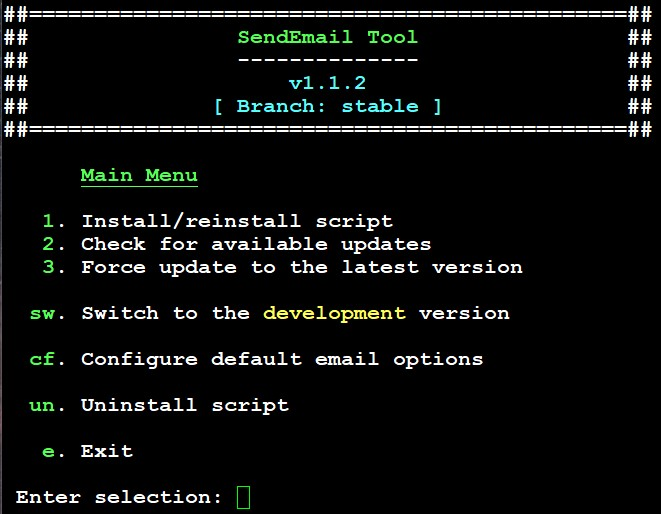
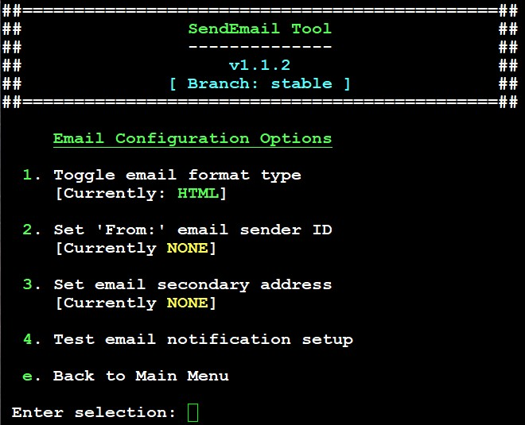
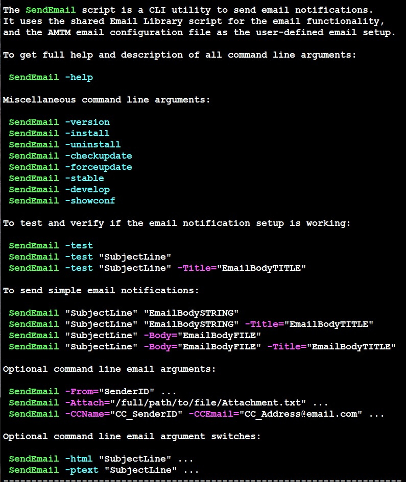

# SendEmail
Shell script tool to send email notifications

## v1.1.2
### Updated on 2026-Oct-19


## About

The **SendEmail** script is a tool that makes it simple and easy to send email notifications from the CLI or from within any other script. It leverages the shared Custom Email Library script (**/jffs/addons/shared-libs/CustomEMailFunctions.lib.sh**) to send the emails, and the AMTM email configuration file which provides the user-defined email settings.


## License

The **SendEmail** script is free and open-source software licensed under the
[GNU General Public License version 3.0](LICENSE).

Official SendEmail releases are maintained through this repository:

**https://github.com/Martinski4GitHub/SendEmail**


### Project Author

- **Original Author & Creator:**  @Martinski W.


## Prerequisites

- An ASUS router running **Asuswrt-Merlin** firmware.
- The JFFS scripts feature must be enabled in the firmware.
- Access to the router's command line interface via the SSH server (i.e. Dropbear)
- The user-defined email settings must be configured via AMTM (see '**em.  Email settings**' option).


## Installation

**Manual Installation**

1. To download the script to your router, use the following commands:

```bash
curl  -LSs --retry 3 --retry-delay 5 --retry-connrefused \
https://raw.githubusercontent.com/Martinski4GitHub/SendEmail/master/SendEmail.sh \
-o /jffs/scripts/SendEmail.sh && chmod a+x /jffs/scripts/SendEmail.sh
```

2. To install the script, use the following command:

```bash
 /jffs/scripts/SendEmail.sh -install
```

The script file is installed in the '**/jffs/addons/SendEmail.d/**' directory with a symbolic link in the '**/jffs/scripts/**' directory.

To get see the full list of command line arguments and switches, use the following command:

```bash
 /jffs/scripts/SendEmail -help
```


## Features:

To send emails, there are 3 basic calls:

1. To test and verify your current email settings from the AMTM email configuration file:

```bash
 /jffs/scripts/SendEmail -test
```


2. To send a simple one-line email where the email message string is provided in the command line:

```bash
 /jffs/script/SendEmail "Subject Line" "The Email Message Body String"
```


3. To send a multi-line/multi-paragraph email where the contents of the email message body is provided via a local text file:

```bash
 /jffs/scripts/SendEmail "Subject Line" -Body="/full/path/to/the/EmailBody.txt"
```

### Removing Temporary Files

If the body of the email is set to be in a file located under the '/tmp/' directory:
```bash
  -Body="/tmp/path/to/the/EmailBody.txt"
```
The file will be automatically deleted *after* the email is successfully sent. This is done to prevent the accumulation of these temporary files. Keep in mind that files under the '/tmp/' directory are considered volatile and, therefore, subject to deletion at any time, and SendEmail may be called by other 3rd-party scripts under various conditions.

If, for any reason, you wish to preserve the body of the email *after* the email has been successfully sent, create the file in another location within a non-volatile filesystem.


###
Other optional arguments are available if you want to add/change the "**From:**" sender ID, include an email title line, change the default format from **HTML** to **Plain Text**, or add a secondary email address that will receive emails along with the primary recipient.

To see the full description of the available arguments, run the following command:

```bash
 /jffs/scripts/SendEmail -help
```

To use the CLI menu for some available operations, simply type:

```bash
 /jffs/scripts/SendEmail
```


### Email File Attachment 

Command-line argument to send an email file attachment:

```bash
  Attach="/file/path/to/emailAttachment.txt"
```

This argument allows users to send a single text file as an email attachment. The text file type is determined by its filename extension. The following extensions will tag the attachment as a text file:<br>
&nbsp;&emsp;**.txt**, &nbsp;**.log**, &nbsp;**.cfg**, &nbsp;**.conf**, &nbsp;**.sh**, &nbsp;**.js**, &nbsp;**.json**, &nbsp;**.TXT**, &nbsp;**.LOG**, &nbsp;and &nbsp;**.CFG**

The maximum file size allowed for an email attachment is **10MB**. Anything larger will generate an error, and the email will **not** be sent. This check is done to prevent users from accidentally sending a 30MB (or ~100MB) attachment. 10MB should be large enough to send any useful text/log file with relevant information (e.g. for troubleshooting or diagnostic purposes).

Other file types (**jpg**, **png**, **bmp**, **gif**, **zip**, **gzip**, **tar**, **pdf**) are also allowed as file attachments. The maximum file size applies to **all** file types. Note that some email providers do not accept certain file types as email attachments.


###
## Main Menu



###
## Email Configuration Options Menu



###
## Brief Help Page



